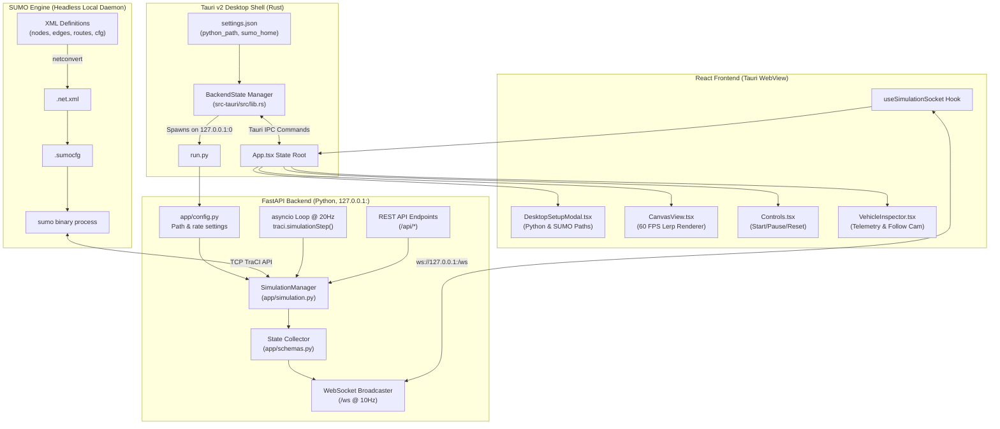

# AGENTS.md: Traffis Codebase Guide & Architecture Map

Welcome to **Traffis**. This document serves as the primary system map, architectural blueprint, and development guide for AI agents (and human engineers) working on this codebase.

---

## 1. Project Overview & Mission

**Traffis** is a real-time microscopic traffic simulation and visualization **desktop application**. It pairs a high-fidelity traffic physics engine with a native desktop shell and an interactive canvas viewport:
- **Desktop Shell**: [Rust + Tauri v2](file:///Users/vijay/Projects/traffis/src-tauri/src/lib.rs) native window manager that auto-detects (or prompts for) local Python and SUMO paths, spawns the local FastAPI backend on an ephemeral loopback port, and cleans up processes on exit.
- **Simulation Engine**: [Eclipse SUMO (Simulation of Urban MObility)](https://eclipse.dev/sumo/) running in headless daemon mode on the user's machine.
- **Backend Application**: [Python 3.12+ FastAPI](file:///Users/vijay/Projects/traffis/backend/app/main.py) communicating with SUMO via [TraCI (Traffic Control Interface)](file:///Users/vijay/Projects/traffis/backend/app/simulation.py) over a local TCP socket.
- **Data Streaming**: Local loopback WebSocket broadcasting vehicle kinematics and network metrics at **10 Hz** (with SUMO physics stepping at **20 Hz / 50ms ticks**). No authentication, rate limiting, bandwidth caps, or simulation time limits.
- **Frontend Dashboard**: [React 19 + TypeScript + Vite](file:///Users/vijay/Projects/traffis/frontend) running inside Tauri's native WebView, rendering an **HTML5 Canvas viewport (60 FPS interpolated)**, telemetry HUD, and simulation controls.

> The legacy browser-hosted release is preserved on the `release/v1-browser` git branch.

---

## 2. High-Level Architecture & Data Flow



---

## 3. Directory & File Structure Map

```text
/Users/vijay/Projects/traffis/
├── AGENTS.md                     # [This file] Primary guide for AI agents & engineers
├── README.md                     # Human-facing introduction & desktop setup documentation
├── DEPLOYMENT.md                 # Desktop development, building & packaging guide
├── src-tauri/                    # Rust + Tauri v2 desktop application shell
│   ├── Cargo.toml                # Rust dependencies (tauri v2, tauri-plugin-dialog, serde)
│   ├── build.rs                  # Tauri build script
│   ├── tauri.conf.json           # Window settings, Vite dev/build commands, bundle metadata
│   ├── capabilities/
│   │   └── default.json          # Tauri v2 permissions (core, native file/folder dialog)
│   ├── icons/
│   │   └── icon.png              # Application icon
│   └── src/
│       ├── main.rs               # Desktop binary entrypoint
│       └── lib.rs                # Path detection/validation, settings persistence, Python process manager
├── backend/                      # Python FastAPI + SUMO TraCI service
│   ├── .venv/                    # Python virtual environment
│   ├── requirements.txt          # Python dependencies (fastapi, uvicorn, traci, sumolib, pydantic)
│   ├── run.py                    # Backend server entry point (pre-build check + uvicorn)
│   ├── test_ws.py                # Standalone E2E verification test for WebSockets & TraCI
│   ├── app/                      # Application package
│   │   ├── __init__.py           # Package marker
│   │   ├── config.py             # Settings, SUMO_HOME resolver, TRAFFIS_HOST/PORT env overrides
│   │   ├── schemas.py            # Pydantic schemas (VehicleData, Stats, StateMessage, NetworkInfo)
│   │   ├── simulation.py         # SimulationManager class: TraCI controller & 20Hz async loop
│   │   ├── main.py               # FastAPI app, lifespan setup, REST endpoints & WebSocket route
│   │   └── scenarios/            # BaseScenario + one module per scenario (registry.py registers them)
│   │       ├── gnt_circle.py     # GNT Circle roundabout: O-D flows -> .rou.xml, polyline geometry, junction metrics
│   │       ├── nallagandla_junction.py # Nallagandla Junction: 3-way signalised T-junction with free-lefts
│   │       └── net_geometry.py   # Reads lane/junction polylines from a compiled .net.xml
│   └── sumo_config/              # SUMO road geometry and routes
│       ├── build_network.py      # Python script to compile .nod.xml & .edg.xml into .net.xml
│       ├── road.nod.xml          # Node/junction definitions (start at 0.0, end at 1000.0)
│       ├── road.edg.xml          # Edge definition (lane geometry & speed limit)
│       ├── road.net.xml          # Compiled SUMO binary road network (generated)
│       ├── road.rou.xml          # Vehicle type definitions (car, truck, sports, van) & route
│       └── road.sumocfg          # Master SUMO configuration file
└── frontend/                     # React + TypeScript + Vite UI (hosted in Tauri WebView)
    ├── index.html                # HTML entry point, fonts & metadata
    ├── package.json              # Frontend + Tauri CLI/API dependencies
    ├── vite.config.ts            # Vite config with dev server on port 5173
    ├── tsconfig.json             # Root TypeScript config
    ├── tsconfig.app.json         # Browser/WebView TypeScript compilation rules
    ├── tsconfig.node.json        # Node/Vite tooling TypeScript configuration
    ├── .oxlintrc.json            # Oxlint static analysis rules
    └── src/
        ├── main.tsx              # React DOM initialization
        ├── App.tsx               # Root component, Tauri startup check, camera & hotkeys
        ├── App.css               # App-level styling
        ├── index.css             # Design tokens, CSS variables & resets
        ├── types/
        │   └── simulation.ts     # TypeScript interfaces matching backend Pydantic models
        ├── hooks/
        │   └── useSimulationSocket.ts # WebSocket connection to dynamic 127.0.0.1:<port>, auto-reconnect
        ├── components/
        │   ├── DesktopSetupModal.tsx  # Python & SUMO_HOME path configuration modal with native Browse pickers
        │   ├── LandingPage.tsx        # Overview & scenario gallery view
        │   ├── CompareSimulationsPage.tsx # Batch scenario comparison & report view
        │   ├── AboutModal.tsx         # About popup with system specs & architecture
        │   ├── Header.tsx             # Top status bar, scenario selector, Paths button, audio toggle
        │   ├── CanvasView.tsx         # HTML5 Canvas viewport: pan/zoom/follow, traffic gantry & 60fps lerp
        │   ├── Controls.tsx           # Transport dock: Start / Pause / Reset + uncapped elapsed clock & telemetry
        │   ├── StatsPanel.tsx         # Telemetry metrics (active count, speed, lane distribution)
        │   ├── JunctionMetricsPanel.tsx # Junction metrics (per-arm flows, ring occupancy, U-turns, queues)
        │   ├── VehicleInspector.tsx   # Floating inspector card for individual vehicle telemetry
        │   └── ScenarioConfigPanel.tsx # Floating scenario config panel (e.g. toggle roundabout signals)
        └── utils/
            ├── tauri.ts               # Tauri IPC wrappers, dynamic backend port URLs, native file/folder pickers
            ├── audio.ts               # Web Audio API procedural sound synthesizer
            └── geometryRenderer.ts    # Polyline network renderer from .net.xml shapes
```

---

## 4. Key Components & Responsibilities

### 4.1 Desktop Shell ([`src-tauri/`](file:///Users/vijay/Projects/traffis/src-tauri))

| Module | Primary Responsibility | Critical Commands / Functions |
| :--- | :--- | :--- |
| [`src/lib.rs`](file:///Users/vijay/Projects/traffis/src-tauri/src/lib.rs) | Manages Python & SUMO path discovery/validation, persists `settings.json` in Tauri's app config dir, launches `backend/run.py` on a free `127.0.0.1` port, polls `/api/health`, and terminates the child process on exit. | `get_desktop_status`, `save_and_start_backend`, `stop_backend`, `detect_python()`, `detect_sumo_home()`, `start_backend_process()`. |
| [`tauri.conf.json`](file:///Users/vijay/Projects/traffis/src-tauri/tauri.conf.json) | Configures native window dimensions, `beforeDevCommand` / `beforeBuildCommand` (targeting `../frontend`), and bundle settings. | `build.devUrl`, `build.frontendDist`. |
| [`capabilities/default.json`](file:///Users/vijay/Projects/traffis/src-tauri/capabilities/default.json) | Grants core window and native file/folder picker (`dialog:default`) permissions to the main window. | `core:default`, `dialog:default`. |

### 4.2 Backend ([`backend/`](file:///Users/vijay/Projects/traffis/backend))

| Module | Primary Responsibility | Critical Methods / Classes |
| :--- | :--- | :--- |
| [`app/config.py`](file:///Users/vijay/Projects/traffis/backend/app/config.py) | Configuration management and path auto-detection. Reads `TRAFFIS_HOST`, `TRAFFIS_PORT`, and `SUMO_HOME` env vars. | `resolve_sumo_home()`, `resolve_sumo_binary()`, `Settings` class (`settings` singleton). |
| [`app/schemas.py`](file:///Users/vijay/Projects/traffis/backend/app/schemas.py) | Data exchange contracts validated via Pydantic v2. | `VehicleData`, `SimulationStats`, `SimulationStateMessage`, `SpawnRequest`, `NetworkInfo`. |
| [`app/simulation.py`](file:///Users/vijay/Projects/traffis/backend/app/simulation.py) | **Core orchestrator**. Owns TraCI process lifecycle, runs the 20 Hz simulation loop (uncapped duration), manages auto-spawning, coordinates async locks, and extracts vehicle kinematics. | `SimulationManager`, `start()`, `stop()`, `reset()`, `play()`, `pause()`, `run_benchmark()`, `_simulation_loop()`, `_collect_current_state()`. |
| [`app/main.py`](file:///Users/vijay/Projects/traffis/backend/app/main.py) | FastAPI application with ASGI lifespan handler. Exposes local REST endpoints and bidirectional WebSocket at `/ws` without authentication or bandwidth throttling. | `lifespan(app)`, `websocket_endpoint()`, `/api/health`, `/api/network-info`, `/api/play`, `/api/pause`, `/api/reset`, `/api/scenario/select`. |
| [`sumo_config/build_network.py`](file:///Users/vijay/Projects/traffis/backend/sumo_config/build_network.py) | Generates SUMO XML files and executes `netconvert` to compile `.net.xml` networks. | `build()`, `find_sumo_binary()`. |
| [`run.py`](file:///Users/vijay/Projects/traffis/backend/run.py) | Backend entrypoint launched by Tauri (or manually). Verifies network compilation before starting `uvicorn`. | Direct execution: `python run.py`. |

### 4.3 Frontend ([`frontend/`](file:///Users/vijay/Projects/traffis/frontend))

| Component / File | Primary Responsibility |
| :--- | :--- |
| [`src/utils/tauri.ts`](file:///Users/vijay/Projects/traffis/frontend/src/utils/tauri.ts) | Detects Tauri runtime, invokes Rust commands, builds dynamic `http://127.0.0.1:<port>` / `ws://127.0.0.1:<port>/ws` URLs, and opens native file/folder dialogs. |
| [`src/components/DesktopSetupModal.tsx`](file:///Users/vijay/Projects/traffis/frontend/src/components/DesktopSetupModal.tsx) | Environment setup dialog prompting for Python executable and `SUMO_HOME` paths when auto-detection fails or when opened via the Header **Paths** button. |
| [`src/types/simulation.ts`](file:///Users/vijay/Projects/traffis/frontend/src/types/simulation.ts) | TypeScript type definitions mirroring backend schemas. |
| [`src/hooks/useSimulationSocket.ts`](file:///Users/vijay/Projects/traffis/frontend/src/hooks/useSimulationSocket.ts) | Manages WebSocket lifecycle against the Tauri-managed backend port, auto-reconnect (1.5s), message dispatch, and REST fallbacks. |
| [`src/App.tsx`](file:///Users/vijay/Projects/traffis/frontend/src/App.tsx) | Root application state: Tauri backend status bootstrapping, camera coordinates, selected vehicle ID, audio preferences, keyboard listeners (`Space` = play/pause, `R` = reset). |
| [`src/components/CanvasView.tsx`](file:///Users/vijay/Projects/traffis/frontend/src/components/CanvasView.tsx) | HTML5 Canvas renderer with `requestAnimationFrame` loop. Computes world-to-screen transforms, interpolates vehicle positions between ticks, and renders road markings, vehicles, signals, and leader indicators. |
| [`src/components/Controls.tsx`](file:///Users/vijay/Projects/traffis/frontend/src/components/Controls.tsx) | Bottom dock with Start/Resume, Pause, Reset, uncapped elapsed time clock, scenario config trigger, and Avg Speed / PCE/h telemetry. |
| [`src/components/VehicleInspector.tsx`](file:///Users/vijay/Projects/traffis/frontend/src/components/VehicleInspector.tsx) | Floating HUD displayed when clicking a vehicle (speed, acceleration, leader distance, Follow Cam). |
| [`src/components/Header.tsx`](file:///Users/vijay/Projects/traffis/frontend/src/components/Header.tsx) | Top navbar with scenario dropdown, live WebSocket status badge, audio toggle, **Paths** settings button, Compare button, and About modal trigger. |

---

## 5. Domain Concepts, Coordinate Systems & Physics

### 5.1 Highway Geometry
- **Length**: Exactly **1000.0 meters** ($X \in [0.0, 1000.0]$).
- **Lanes**: 4 lanes total (2 lanes in each direction separated by a center median, driving on left side):
  - **Eastbound Carriageway** ($Y \in [0.0, +6.4\text{m}]$, travel West $\to$ East, heading $90^\circ$):
    - `EB Lane 0` (Left / Kerbside Slow Lane): Center $Y = +4.8\text{m}$.
    - `EB Lane 1` (Right / Median Fast Overtaking Lane): Center $Y = +1.6\text{m}$.
  - **Center Median**: Centerline divider at $Y = 0.0\text{m}$ (double solid yellow lines).
  - **Westbound Carriageway** ($Y \in [-6.4\text{m}, 0.0]$, travel East $\to$ West, heading $270^\circ$):
    - `WB Lane 1` (Right / Median Fast Overtaking Lane): Center $Y = -1.6\text{m}$.
    - `WB Lane 0` (Left / Kerbside Slow Lane): Center $Y = -4.8\text{m}$.
  - Lane width is **3.2 meters** each. Total carriageway width is **12.8 meters** ($Y \in [-6.4, +6.4]$).
- **Traffic Signal**: Junction at $X = 500.0\text{m}$ (`traffic_light` node) dividing the highway with dual stop lines ($X = 497.5\text{m}$ on Eastbound $+Y$, $X = 502.5\text{m}$ on Westbound $-Y$).
- **Speed Limit**: Default $33.33\text{ m/s}$ ($120\text{ km/h}$).

### 5.2 Vehicle Types & Parameters
Defined in [`backend/sumo_config/road.rou.xml`](file:///Users/vijay/Projects/traffis/backend/sumo_config/road.rou.xml):
- `car`: Standard passenger car ($L = 5.0\text{m}$, $W = 1.8\text{m}$, Max Speed $33.33\text{ m/s}$, Accel $2.6\text{ m/s}^2$, Decel $4.5\text{ m/s}^2$).
- `sports`: Fast sports sedan ($L = 4.6\text{m}$, $W = 1.9\text{m}$, Max Speed $45.0\text{ m/s}$, Accel $4.2\text{ m/s}^2$, Decel $6.0\text{ m/s}^2$).
- `truck`: Heavy transport ($L = 10.0\text{m}$, $W = 2.4\text{m}$, Max Speed $25.0\text{ m/s}$, Accel $1.3\text{ m/s}^2$, Decel $3.5\text{ m/s}^2$).
- `van`: Light commercial delivery ($L = 5.5\text{m}$, $W = 2.0\text{m}$, Max Speed $30.0\text{ m/s}$, Accel $2.2\text{ m/s}^2$, Decel $4.2\text{ m/s}^2$).

### 5.3 Units & Conversions
- **SUMO / TraCI Internal**: Meters ($\text{m}$), seconds ($\text{s}$), meters per second ($\text{m/s}$), meters per second squared ($\text{m/s}^2$).
- **UI Display**: Speed in kilometers per hour ($\text{km/h} = \text{speed}_{\text{m/s}} \times 3.6$).
- **Canvas World-to-Screen Mapping**:
  $$\text{screenX} = (\text{worldX} - \text{camera.x}) \times \text{camera.zoom} + \frac{\text{canvasWidth}}{2}$$
  $$\text{screenY} = (\text{worldY} - \text{camera.y}) \times \text{camera.zoom} + \frac{\text{canvasHeight}}{2}$$

### 5.4 GNT Circle Driver Behaviour & Aggression Tuning
Full details: [`SPEC.md` §5.2.5](file:///Users/vijay/Projects/traffis/backend/sumo_config/scenarios/gnt_circle/SPEC.md):
- **Vehicle mix**: `car` 85% / `van` 15% in [`scenario.xml`](file:///Users/vijay/Projects/traffis/backend/sumo_config/scenarios/gnt_circle/scenario.xml) `<vehicleMix>`.
- **Global behaviour**: `<behaviour>` params in `scenario.xml` (`impatience`, `jmIgnoreFoeProb`, `jmTimegapMinor`, `lc*`, ...), re-read on every reset.
- **Extra aggression & right-of-way forcing**: Applied per vehicle in [`GntCircleScenario._make_aggressive()`](file:///Users/vijay/Projects/traffis/backend/app/scenarios/gnt_circle.py) and `_update_force_mode()`.
- **Connection settings**: Defined in [`gnt_circle.con.xml`](file:///Users/vijay/Projects/traffis/backend/sumo_config/scenarios/gnt_circle/gnt_circle.con.xml). Re-run `python backend/sumo_config/build_network.py` after editing.

---

## 6. Communication Protocols & APIs

### 6.1 Tauri IPC Commands (`src-tauri/src/lib.rs`)
- `get_desktop_status()` → returns saved/detected Python & SUMO paths, active loopback port, running state, and any startup error.
- `save_and_start_backend(pythonPath, sumoHome)` → validates paths, persists `settings.json`, spawns `backend/run.py` on a free port, and waits for `/api/health`.
- `stop_backend()` → terminates the managed Python/SUMO backend process.

### 6.2 WebSocket Protocol (`ws://127.0.0.1:<port>/ws`)

#### Server to Client Messages
1. **Network Info** (sent on initial connection):
   ```json
   {
     "type": "network_info",
     "data": {
       "road_length": 1000.0,
       "num_lanes": 4,
       "lane_width": 3.2,
       "traffic_light_x": 500.0,
       "lanes": [...]
     }
   }
   ```
2. **State Broadcast** (10 Hz with SUMO physics at 20 Hz):
   ```json
   {
     "type": "state",
     "sim_time": 14.25,
     "step": 285,
     "is_running": true,
     "scenario_id": "straight_road",
     "compact_vehicles": [
       ["veh_1", 245.8, -1.6, 13.9, 0.1, 90.0, 1, "car", "#38bdf8", 5.0, 1.8, "veh_0", 42.1, "east"]
     ],
     "stats": {
       "active_vehicles": 8,
       "total_spawned": 12,
       "total_arrived": 4,
       "avg_speed_kmh": 49.9,
       "density_veh_km": 8.0,
       "pce_per_hour": 1500.0
     },
     "traffic_light": {
       "id": "traffic_light",
       "x": 500.0,
       "state": "green",
       "raw_state": "GGGG",
       "mode": "auto",
       "green_duration": 15.0,
       "yellow_duration": 3.0,
       "red_duration": 12.0,
       "phase_timer": 3.5,
       "phase_remaining": 11.5,
       "next_state": "yellow"
     },
     "default_speed_kmh": 50.0
   }
   ```

#### Client to Server Commands
- `{"action": "play"}`
- `{"action": "pause"}`
- `{"action": "reset"}`
- `{"action": "select_scenario", "payload": {"scenario_id": "four_way_intersection"}}`
- `{"action": "update_scenario_options", "payload": {"options": {"roundabout_signals": true, "time_lapse": true}}}`

### 6.3 REST Endpoints (`http://127.0.0.1:<port>/api/*`)

| Method | Endpoint | Description |
| :--- | :--- | :--- |
| `GET` | `/api/health` | Backend status, active client count, SUMO init status. |
| `GET` | `/api/network-info` | Road dimensions, traffic light position, lane specifications, and signal heads. |
| `POST` | `/api/play` | Resume simulation loop. |
| `POST` | `/api/pause` | Pause simulation loop. |
| `POST` | `/api/reset` | Close and restart SUMO, reset clock to $0.0\text{s}$. |
| `GET` | `/api/scenarios` | List available scenarios (supports `?grouped=true`). |
| `GET` | `/api/scenarios/groups` | List scenarios organized by group according to `scenario_groups.json`. |
| `POST` | `/api/scenario/select` | Switch scenario (`{"scenario_id": "..."}`). |
| `POST` | `/api/scenario/options` | Update scenario options at runtime (`{"options": {"roundabout_signals": true}}`). |
| `POST` | `/api/simulation/compare-run` | Run a scenario in fast headless batch mode and return benchmark metrics. |

---

## 7. Concurrency, Locking & Performance Patterns

### 7.1 TraCI Thread-Safety
- **Constraint**: TraCI communicates with SUMO via a synchronous TCP socket. Multiple concurrent calls to `traci.*` will corrupt the socket stream.
- **Pattern**: [`SimulationManager`](file:///Users/vijay/Projects/traffis/backend/app/simulation.py) wraps every TraCI interaction inside `async with self.lock:`.
- **Broadcast Isolation**: State serialization and WebSocket broadcasting run *outside* the lock.

### 7.2 Decoupled Physics & Rendering (20Hz Physics -> 10Hz Broadcast -> 60FPS Display)
- **Physics @ 20 Hz**: SUMO steps at $0.05\text{s}$ for Krauss car-following and gap acceptance accuracy.
- **State Broadcast @ 10 Hz**: Compact positional tuples (`compact_vehicles`) sent over local loopback WebSocket.
- **Smooth 60 FPS Viewport**: [`CanvasView.tsx`](file:///Users/vijay/Projects/traffis/frontend/src/components/CanvasView.tsx) interpolates vehicle coordinates via `requestAnimationFrame` lerp.

---

## 8. Development, Run & Test Workflows

### 8.1 Launch Desktop App (Dev Mode)
```bash
cd /Users/vijay/Projects/traffis
npm --prefix frontend run tauri dev
```
This starts the Vite dev server, compiles the Rust Tauri shell, opens the native desktop window, and auto-launches the Python/SUMO backend (or prompts for Python and `SUMO_HOME` paths if not detected).

### 8.2 Build Native Desktop Bundle
```bash
cd /Users/vijay/Projects/traffis
npm --prefix frontend run tauri build
```

### 8.3 Automated Testing & Verification
```bash
# 1. Lint & Build Frontend
npm --prefix frontend run lint
npm --prefix frontend run build

# 2. Check Rust / Tauri Shell
cargo check --manifest-path src-tauri/Cargo.toml

# 3. Verify Backend Imports
backend/.venv/bin/python -c "import sys; sys.path.insert(0, 'backend'); from app.main import app; print(app.title)"

# 4. Run WebSocket + TraCI End-to-End Test (with backend running on port 8000)
cd backend && ./.venv/bin/python test_ws.py
```

---

## 9. Common Recipes for AI Agents Extending Traffis

### Recipe 1: Adding a New Vehicle Type
1. Edit [`backend/sumo_config/road.rou.xml`](file:///Users/vijay/Projects/traffis/backend/sumo_config/road.rou.xml) (and [`backend/sumo_config/build_network.py`](file:///Users/vijay/Projects/traffis/backend/sumo_config/build_network.py)).
2. Update allowed types in [`backend/app/schemas.py`](file:///Users/vijay/Projects/traffis/backend/app/schemas.py) and [`backend/app/simulation.py`](file:///Users/vijay/Projects/traffis/backend/app/simulation.py).
3. Update [`frontend/src/types/simulation.ts`](file:///Users/vijay/Projects/traffis/frontend/src/types/simulation.ts) and rendering in [`frontend/src/components/CanvasView.tsx`](file:///Users/vijay/Projects/traffis/frontend/src/components/CanvasView.tsx).

### Recipe 2: Adding a New Tauri Desktop Command
1. Add a `#[tauri::command]` function in [`src-tauri/src/lib.rs`](file:///Users/vijay/Projects/traffis/src-tauri/src/lib.rs) and register it inside `tauri::generate_handler![...]`.
2. Add a typed TypeScript wrapper in [`frontend/src/utils/tauri.ts`](file:///Users/vijay/Projects/traffis/frontend/src/utils/tauri.ts) using `invoke(...)`.
3. If the command uses a new Tauri plugin, add the required permission to [`src-tauri/capabilities/default.json`](file:///Users/vijay/Projects/traffis/src-tauri/capabilities/default.json).

### Recipe 3: Adding a New Road / Simulation Scenario
1. **Network XML Definition**: Add nodes, edges, routes, and `.sumocfg` under `backend/sumo_config/scenarios/<scenario_id>/` and compile `.net.xml` via `build_network.py`.
2. **Backend Scenario Class**: Create `backend/app/scenarios/<scenario_id>.py` extending [`BaseScenario`](file:///Users/vijay/Projects/traffis/backend/app/scenarios/base.py).
3. **Register Scenario**: Register it in [`backend/app/scenarios/registry.py`](file:///Users/vijay/Projects/traffis/backend/app/scenarios/registry.py).
4. **Frontend Canvas Support**: Reuse `utils/geometryRenderer.ts` by returning polyline `geometry` in `NetworkInfo`, or add a custom renderer in [`CanvasView.tsx`](file:///Users/vijay/Projects/traffis/frontend/src/components/CanvasView.tsx).
