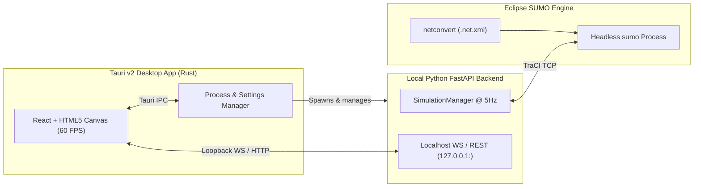

# Traffis — Microscopic Traffic Simulation Desktop App

A high-performance microscopic traffic simulation desktop application powered by **Rust + Tauri v2**, **Eclipse SUMO (Simulation of Urban MObility)**, **Python FastAPI with TraCI**, and a **React + TypeScript + HTML5 Canvas** viewport.


> **Note:** Traffis is a local desktop application with no login, no bandwidth limits, and no simulation time caps. The legacy browser-hosted release is archived on the `release/v1-browser` branch.

---

## System Architecture



- **Tauri Rust shell (`src-tauri/`)** auto-detects your local Python and `SUMO_HOME` installations (or prompts you to browse for them on first launch), starts the Python backend on a free `127.0.0.1` port, and cleanly stops both Python and SUMO when you close the app.
- **Python + SUMO (`backend/`)** runs SUMO physics and streams compact vehicle telemetry over loopback WebSockets at **5 Hz** (`0.2s` step length).
- **React + Canvas (`frontend/`)** renders roads, signals, junction metrics, and 60 FPS interpolated vehicles inside the native OS WebView.

---

## Prerequisites

Install the following on your machine before running Traffis:

1. **Eclipse SUMO (1.20+)** (`sumo` and `netconvert` binaries + `SUMO_HOME` directory):
   - **macOS (Official DMG)**: Download from [eclipse.dev/sumo](https://eclipse.dev/sumo/) (installs to `/Library/Frameworks/EclipseSUMO.framework/Versions/Current/EclipseSUMO/share/sumo`).
   - **macOS (Homebrew)**: `brew install sumo` (installs `SUMO_HOME` to `$(brew --prefix sumo)/share/sumo`).
   - **Linux (Ubuntu/Debian)**: `sudo apt-get install sumo sumo-tools`.
   - **Windows**: Download installer from [eclipse.dev/sumo](https://eclipse.dev/sumo/).
2. **Python 3.12+**
3. **Node.js 20+ & npm**
4. **Rust & Cargo** (for building the Tauri desktop shell)

---

## Quick Start

### 1. Set Up the Python Backend Environment
```bash
cd backend
python3 -m venv .venv
source .venv/bin/activate   # Windows: .venv\Scripts\activate
pip install -r requirements.txt
cd ..
```

### 2. Install Frontend & Tauri CLI Dependencies
```bash
cd frontend
npm install
cd ..
```

### 3. Launch the Desktop App
From the repository root:
```bash
npm --prefix frontend run tauri dev
```

On startup, Traffis automatically detects `backend/.venv/bin/python` and your `SUMO_HOME` directory. If either cannot be found, a **Desktop Environment Setup** modal will prompt you to enter or browse for the paths and save them for future launches. You can also reconfigure paths anytime via the **Paths** button in the top header.

### 4. Build a Production Desktop Bundle
```bash
npm --prefix frontend run tauri build
```

For full build, verification, and troubleshooting details, see [DEPLOYMENT.md](DEPLOYMENT.md).

---

## Features & Controls

- **Scenarios**: Switch between straight corridors, 3-way and 4-way signalized intersections, and curved/roundabout networks (such as GNT Circle and Nallagandla Junction).
- **Transport Controls**:
  - **Start / Pause** (`Space`): Run or pause real-time SUMO physics with no duration limit.
  - **Reset** (`R`): Clear active vehicles and reset simulation time to `0:00`.
- **Interactive Viewport**:
  - **Pan**: Click and drag on the canvas.
  - **Zoom**: Mouse scroll wheel.
  - **Vehicle Inspector**: Click any vehicle to inspect speed, acceleration, leader distance, and toggle camera follow.
- **Compare Simulations**: Run multiple scenarios in headless batch mode and compare throughput, average speed, delay, and queue metrics side-by-side.

---

## Verification & Testing

```bash
# Lint & typecheck frontend
npm --prefix frontend run lint
npm --prefix frontend run build

# Check Rust / Tauri compilation
cargo check --manifest-path src-tauri/Cargo.toml
```

---

## Troubleshooting

| Issue | Solution |
| :--- | :--- |
| Python packages missing (`fastapi`, `uvicorn`, `traci`) | Point the **Python Executable Path** in the setup modal to `backend/.venv/bin/python` (or `backend\.venv\Scripts\python.exe` on Windows) after running `pip install -r backend/requirements.txt`. |
| `sumo` or `netconvert` not found | Point **SUMO_HOME** in the setup modal to your SUMO `share/sumo` directory (or Windows `Eclipse\Sumo` directory) and verify `sumo --version` works. |
| Port conflicts | Tauri automatically binds the backend to a free ephemeral `127.0.0.1` port on every launch, so port `8000` conflicts do not occur in desktop mode. |
