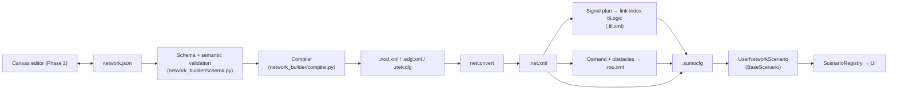

# Network Builder — Task Plan

Self-serve road network creation for Traffis Desktop. Users describe road sections, lane counts, junctions, signal timings, traffic demand and obstacles; Traffis compiles that description into SUMO inputs and runs it like any built-in scenario.

> **Status legend:** ☐ todo · ◐ in progress · ☑ done

---

## 1. Goals & Non-Goals

**Goals**
- A single, human-readable project file (`network.json`) is the source of truth for a user network.
- A deterministic compiler turns `network.json` into SUMO inputs (`.nod/.edg/.net/.rou/.tll/.sumocfg`) via `netconvert`.
- Compiled networks appear in the scenario list and run with the existing simulation loop, canvas renderer, metrics and Compare page — no special-casing in `simulation.py`.
- Errors are reported in user terms ("Road `A_J1` references unknown junction `J9`"), not raw SUMO stack traces.
- Later phases add a drag-and-drop canvas editor that reads/writes the same file.

**Non-goals (for now)**
- Bundling SUMO/Python (still a user prerequisite).
- Pedestrians, public transport, actuated signals, multi-modal routing.
- Calibrating demand to observed per-section counts (planned for Phase 4 via `routeSampler`).

---

## 2. Architecture



### 2.1 File locations
| What | Where |
| :--- | :--- |
| Bundled examples (read-only) | `backend/app/network_builder/examples/<id>/network.json` |
| User networks | `$TRAFFIS_NETWORKS_DIR/<id>/network.json` (default `~/Traffis/networks`) |
| Compiled output | `<network dir>/build/` (regenerated; safe to delete) |

### 2.2 Scenario integration
- Scenario id: `net_<network id>`; group: **My Networks**.
- `demand_from_route_file = True`, `apply_default_speed_limit = False` (per-road speeds).
- Signals run natively in SUMO from the compiled `tlLogic`; the scenario only *reports* state (supports multiple signalised junctions).
- Compilation is lazy and cached by a content hash of `network.json` + compiler version; `reload_settings()` (called before every start/reset) recompiles when stale, so validation errors surface before the running SUMO instance is torn down.

---

## 3. `network.json` Schema (v1)

```jsonc
{
  "schema_version": 1,
  "id": "demo_corridor",                 // [A-Za-z][A-Za-z0-9_]*, unique
  "name": "Demo Corridor",
  "description": "Two signalised junctions on an arterial",
  "settings": {
    "drive_side": "left",                // "left" (India/UK) | "right"
    "default_speed_kmh": 50,
    "lane_width_m": 3.2
  },
  "junctions": [
    { "id": "W", "x": -400, "y": 0, "type": "priority", "label": "West Gate" },
    { "id": "J1", "x": 0, "y": 0, "type": "traffic_light" }
  ],
  "roads": [
    {
      "id": "W_J1", "from": "W", "to": "J1",
      "lanes": 2,                         // lanes in from→to direction
      "lanes_back": 2,                    // lanes in to→from direction; 0 = one-way
      "speed_kmh": 50,                    // optional, defaults to settings
      "points": [[-200, 10]],             // optional intermediate shape points
      "name": "MG Road"
    }
  ],
  "signals": [
    {
      "junction": "J1",
      "amber_s": 3, "all_red_s": 2, "offset_s": 0,
      "phases": [
        { "approaches": ["W_J1", "E_J1"], "green_s": 30 },   // incoming roads that get green together
        { "approaches": ["N_J1", "S_J1"], "green_s": 25 }
      ]
    }
  ],
  "demand": {
    "vehicle_mix": { "car": 0.7, "motorcycle": 0.2, "van": 0.1 },
    "flows": [
      { "id": "W_E", "from": "W", "to": "E", "vehs_per_hour": 600 }  // boundary junction → boundary junction
    ]
  },
  "obstacles": [
    { "id": "breakdown1", "kind": "blockage", "road": "W_J1", "direction": "forward",
      "lane": 0, "position_m": 150, "length_m": 8 },
    { "id": "works1", "kind": "lane_closure", "road": "J1_E", "direction": "backward", "lane": 1 }
  ]
}
```

### 3.1 Concept → SUMO mapping
| Concept | Compiled to |
| :--- | :--- |
| Junction `priority` / `right_before_left` / `allway_stop` / `traffic_light` | `<node type=…>` (traffic lights: `tlType="static"`) |
| Road (two-way) | Two edges `<road>_f` (from→to) and `<road>_b` (to→from), shared centreline, `numLanes`, `speed`, `width`, `shape` |
| Signal phases | `<tlLogic programID="traffis">` built from the compiled net's `linkIndex` table; green → `G`/`g` (yield to green foes per junction foe matrix), then amber `y`, then all-red `r` |
| Junction with `traffic_light` but no plan | netconvert's default static program |
| Vehicle mix | `<vTypeDistribution>` of built-in vTypes (`car`, `sports`, `van`, `truck`, `motorcycle`, `auto_rickshaw`) |
| Flow | `<flow from=<edge leaving origin> to=<edge entering destination>>` (SUMO routes at insertion) |
| Obstacle `blockage` | Parked `obstacle` vehicle with a permanent `<stop>` on the lane (traffic queues/merges around it) |
| Obstacle `lane_closure` | `<lane index=… disallow="all"/>` for the whole road section |

### 3.2 Validation rules
- Unique ids per collection; ids match `[A-Za-z][A-Za-z0-9_]*` (no `.` — SUMO uses it for flow vehicle ids).
- Roads reference existing, distinct junctions; `lanes ≥ 1`, `0 ≤ lanes_back ≤ 8`, speed 5–150 km/h.
- `traffic_light` junctions need ≥ 2 connected roads; a signal plan must target a `traffic_light` junction, list only roads that *enter* that junction, and each phase needs ≥ 1 approach and `green_s ≥ 1`.
- Flow origins/destinations must be boundary junctions (exactly one connected road) with an outgoing/incoming lane respectively; origin ≠ destination; `vehs_per_hour ≥ 0`.
- Vehicle mix keys are built-in types; shares sum to 1 ± 0.01.
- Obstacles target an existing road/direction/lane; `position_m + length_m ≤ road length`.
- Post-compile: every flow must have a path in the compiled net (BFS over `<connection>`s), else "No route from W to E".

---

## 4. Phases & Tasks

### Phase 1 — Project format, compiler, scenario loading ☑ *(completed)*
| # | Task | Status |
| :--- | :--- | :--- |
| 1.1 | Pydantic schema + semantic validation (`network_builder/schema.py`) | ☑ |
| 1.2 | Compiler: plain XML + `netconvert` run, warning/error capture (`compiler.py`) | ☑ |
| 1.3 | Signal plan → link-index `tlLogic` using the compiled net's connections and foe matrix | ☑ |
| 1.4 | Demand (`vTypeDistribution`, flows) + obstacles → `.rou.xml`; lane closures in `.edg.xml` | ☑ |
| 1.5 | Route reachability check for every flow | ☑ |
| 1.6 | Content-hash build cache (skip netconvert when unchanged) | ☑ |
| 1.7 | `UserNetworkScenario`: metadata, geometry (`net_geometry`), signal heads per approach, multi-TLS state reporting, O-D metrics | ☑ |
| 1.8 | Network store (examples + user dir) and registry discovery → **My Networks** group | ☑ |
| 1.9 | REST: `GET /api/networks`, `GET/PUT/DELETE /api/networks/{id}`, `POST /api/networks/validate` | ☑ |
| 1.10 | Example network `demo_corridor` (2 signalised junctions, side roads, blockage, lane closure) | ☑ |
| 1.11 | Tests: validation errors, compile, SUMO run of the example (headless TraCI smoke test) | ☑ |
| 1.12 | Docs: schema reference (`docs/network-builder/SCHEMA.md`), AGENTS.md section | ☑ |

**Exit criteria:** `demo_corridor` appears under *My Networks*, runs in the desktop app with signals cycling, vehicles routing W↔E and via side roads, queues forming behind the blockage; invalid files produce readable errors from `/api/networks/validate`.

### Phase 2 — Canvas editor (MVP) ☑ *(completed)*
| # | Task | Status |
| :--- | :--- | :--- |
| 2.1 | Editor route/view in the app (`NetworkEditorPage.tsx`) reusing canvas pan/zoom/world transforms | ☑ |
| 2.2 | Tools: select, add junction, draw road (click junction → junction), add shape point, delete | ☑ |
| 2.3 | Snapping (grid, existing junctions), live length readout, scale bar | ☑ |
| 2.4 | Property inspector: junction type/label; road lanes/lanes_back/speed/name | ☑ |
| 2.5 | Undo/redo (command stack), dirty-state tracking, keyboard shortcuts | ☑ |
| 2.6 | Save/Open/New via `/api/networks` + import/export `network.json` | ☑ |
| 2.7 | "Validate" and "Save & Run" buttons → compile, show errors pinned to elements, then switch to the scenario | ☑ |
| 2.8 | Render compiled geometry preview (netconvert output) as an overlay toggle (`/api/networks/preview`) | ☑ |

### Phase 3 — Signals, demand & obstacles UI
| # | Task |
| :--- | :--- |
| 3.1 | Signal plan editor per junction: phase list, approach checkboxes, green/amber/all-red, cycle summary |
| 3.2 | Show generated link-level states (read-only) for advanced users |
| 3.3 | Demand panel: vehicle mix sliders (normalised), O-D flow table/matrix |
| 3.4 | Obstacle tool: click a lane to place a blockage; lane-closure toggle in road inspector |
| 3.5 | Render obstacles distinctly on the simulation canvas (cones/barrier instead of vehicle body) |

### Phase 4 — Advanced modelling
| # | Task |
| :--- | :--- |
| 4.1 | Per-turn connection overrides (banned turns, lane-to-lane mapping) → `.con.xml` |
| 4.2 | Roundabout junction type (generated ring geometry + `<roundabout>`) |
| 4.3 | Section-count demand calibration via `routeSampler` ("vehicle density per section") |
| 4.4 | Time-varying demand (peak profiles) and per-flow vehicle mix |
| 4.5 | Actuated signals (`tlType="actuated"`) |

### Phase 5 — Import & productivity
| # | Task |
| :--- | :--- |
| 5.1 | OpenStreetMap import (`netconvert --osm`) → simplify → `network.json` |
| 5.2 | Background image/map tracing layer with scale calibration |
| 5.3 | "Open in netedit" escape hatch for experts |
| 5.4 | Templates (T-junction, crossroads, corridor) and duplicate-network |

---

## 5. Risks & Mitigations
| Risk | Mitigation |
| :--- | :--- |
| Link indices are generated by netconvert, so signal states can't be authored up front | Two-stage compile: netconvert first, then derive `tlLogic` from the compiled `<connection linkIndex>` table |
| Conflicting greens in multi-approach phases (e.g. turning vs. opposing through) | Use the junction foe/response matrix: a green link that must yield to another green link becomes `g` |
| netconvert silently reshapes geometry | Surface netconvert warnings; render compiled geometry (not the user sketch) in the simulator |
| Long compile on large OSM imports | Hash cache; compile off the TraCI lock |
| User files edited by hand become invalid | Strict validation with element-addressed messages; never partially apply |

---

## 6. Verification
- `backend/.venv/bin/python -m unittest discover -s backend/tests` — schema/compiler unit tests + headless SUMO smoke run.
- Manual: `npm --prefix frontend run tauri dev` → select **My Networks › Demo Corridor** → Start.
